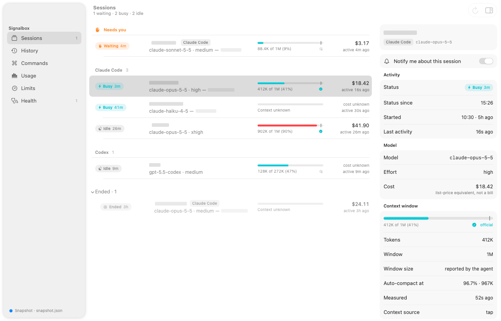
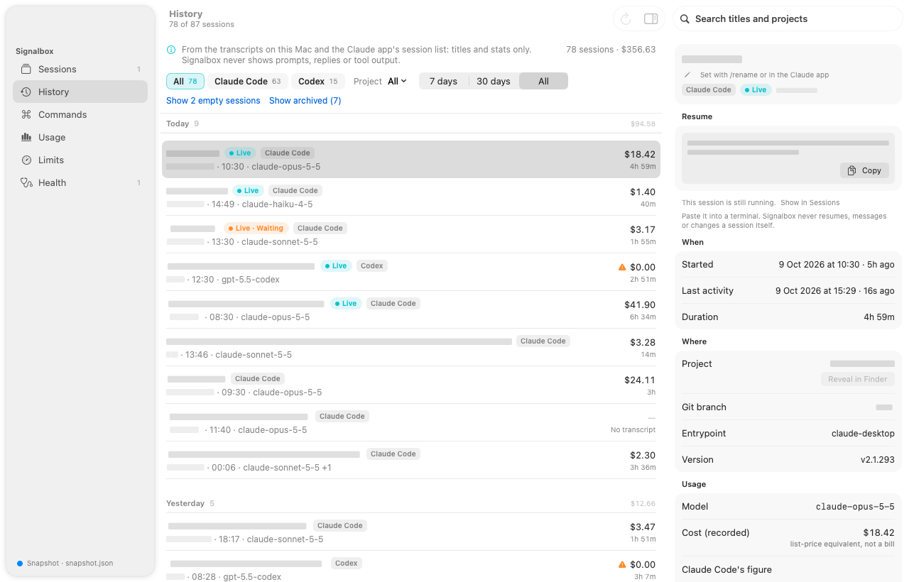
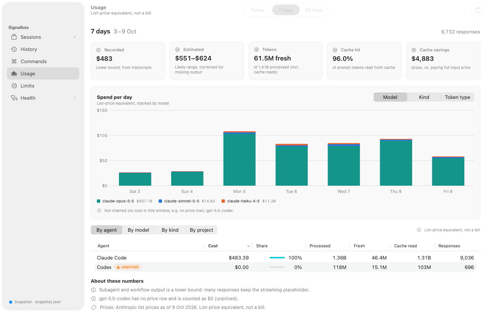
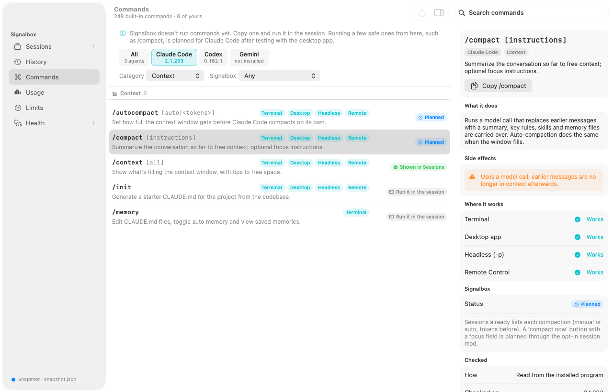
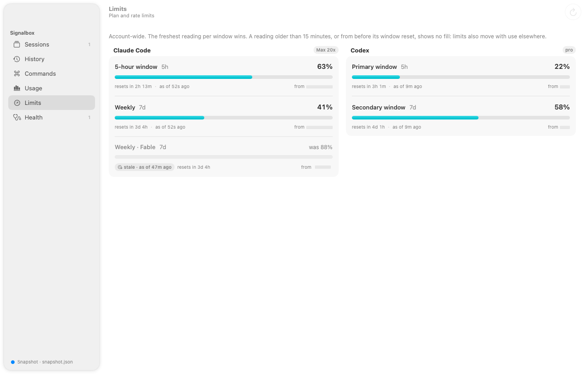
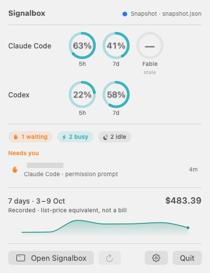

# Signalbox

**A local control room for your AI coding agents.** See every session, its context and plan limits, and what the usage would cost at API list prices, without handing over any credentials.

> **Status:** pre-release (0.1.0). macOS 14 or later. The app is built for Apple Silicon, ad-hoc signed and not notarized.

[What it is](#what-it-is) · [Features](#features) · [Install](#install) · [CLI](#cli) · [How it works](#how-it-works) · [Privacy](#privacy-and-security) · [Accuracy](#accuracy) · [Roadmap](#roadmap) · [Development](#development)

<p align="center">
  <picture>
    <source media="(prefers-color-scheme: dark)" srcset="docs/screenshots/sessions-dark.png">
    
  </picture>
  <br>
  <sub>Screenshots use synthetic sample data, with names and paths redacted.</sub>
</p>

## What it is

Signalbox watches the coding agents on your Mac and puts them in one place. It shows which sessions are running and which one is waiting for you, how full each context window is, how close you are to your plan limits, and what the usage would cost at API list prices. That last figure is useful on a subscription too. Signalbox comes as a native macOS app with a menu bar item, a command-line tool, and a local web page.

- **Claude Code first:** terminal, desktop Code tab and background sessions.
- **Codex:** sessions, usage, plan limits and session names.
- **Gemini CLI:** the command guide. Usage tracking is on the [roadmap](#roadmap).

### What makes it different

- **No credentials.** It reads only the files the agents already write on your Mac. It never reads login tokens or the Keychain, and it never calls undocumented vendor endpoints.
- **Local only.** It makes no network calls and sends no telemetry. The web page listens on 127.0.0.1 only.
- **Desktop sessions included.** Sessions in the Claude desktop app's Code tab appear next to terminal and background sessions. History also matches the app's own session list.
- **Reconciled cost.** Each response is priced from the published price tables. Recorded dollars are checked against a reference script. An estimate calibrated against Claude Code's own cost ledger corrects for what transcripts miss. Every figure is a list-price equivalent, not a bill.
- **Unknown stays unknown.** Missing data reads "unknown", never 0. Every data source declares how stable its format is.

## Features

- **Sessions.** Every live session, plus the ones that ended recently. Each shows its status (busy, waiting or idle) and how long it has been that way, plus its model, a context bar marking where auto-compaction starts, and its cost. The inspector shows where the session runs, its compactions, and copyable suggestions, such as `/compact` once context passes 75%.
- **History.** Past and live sessions grouped by day, like the Claude app's list. Each row has the title, project, start time, model, duration and cost. Search them, or filter by agent, project and date range. Each session has a resume command (`claude --resume <id>` or `codex resume <id>`) that you can copy. Signalbox never resumes a session itself.
- **Usage.** Spend per day, stacked by model, by kind (main, subagent, workflow) or by token type. It shows totals by model and project, recorded and estimated dollars, and fresh and total tokens. Today, 7 days and 30 days are calendar days.
- **Limits.** Plan windows (5-hour, weekly) with their reset times. A bar fills only while its reading is current. A reading older than 15 minutes, or from before its window reset, shows as "stale" or "reset passed" with the last value.
- **Commands.** A guide to every built-in slash command and useful shell command in Claude Code, Codex and Gemini CLI. Each entry says what the command does, where it works, its side effects, and whether Signalbox already shows that information. The guide also lists your own commands, skills and plugin commands, by name and description. Signalbox runs no commands: Copy puts one on the clipboard for you to run in the session.
- **Health.** Each data source, how stable its format is, and whether it's working, as `signalbox doctor` reports them.
- **Menu bar.** Limit rings, the sessions waiting for you, and recorded spend for the report window (7 days by default) with a per-day sparkline. The menu bar label can show the 5-hour %, the weekly % or today's spend. The app can run from the menu bar alone, with no Dock icon.
- **Notifications (opt-in).** Signalbox can tell you when a session needs you and what it's waiting for (for example, "permission prompt"). It can also tell you when a long task finishes or a plan limit passes 80% or 95%. "Needs you" and "finished" arrive about half a second after the status changes; limit alerts come with the regular 15-second refresh. An alert that is off by default says when Signalbox can't read data. You can mute a single session.
- **Settings.** Launch at login, the menu bar label, notification kinds and thresholds, and currency. GBP and EUR use a rate you enter; Signalbox fetches no exchange rates. If you enter your monthly plan price, Usage shows the last 30 days at list price as a multiple of it.

<table>
  <tr>
    <td width="50%" valign="top">
      <picture>
        <source media="(prefers-color-scheme: dark)" srcset="docs/screenshots/history-dark.png">
        
      </picture>
      <br><b>History</b>: every session, grouped by day, with a resume command to copy.
    </td>
    <td width="50%" valign="top">
      <picture>
        <source media="(prefers-color-scheme: dark)" srcset="docs/screenshots/usage-dark.png">
        
      </picture>
      <br><b>Usage</b>: list-price spend per day, recorded and estimated.
    </td>
  </tr>
  <tr>
    <td width="50%" valign="top">
      <picture>
        <source media="(prefers-color-scheme: dark)" srcset="docs/screenshots/commands-dark.png">
        
      </picture>
      <br><b>Commands</b>: what each command does, where it works, and its side effects.
    </td>
    <td width="50%" valign="top">
      <picture>
        <source media="(prefers-color-scheme: dark)" srcset="docs/screenshots/limits-dark.png">
        
      </picture>
      <br><b>Limits</b>: plan windows, with the age of each reading.
    </td>
  </tr>
  <tr>
    <td colspan="2" align="center" valign="top">
      <picture>
        <source media="(prefers-color-scheme: dark)" srcset="docs/screenshots/menubar-dark.png">
        
      </picture>
      <br><b>Menu bar</b>: limits, waiting sessions and recorded spend at a glance.
    </td>
  </tr>
</table>

## Install

### Build from source

You need macOS 14 or later on Apple Silicon, [Bun](https://bun.sh) 1.4 or newer, and Xcode 26 with Swift 6.

```sh
git clone <repository URL> signalbox && cd signalbox
bun install
apps/macos/scripts/build-app.sh --install    # builds dist/signalbox, then Signalbox.app, and copies it to ~/Applications
open ~/Applications/Signalbox.app
```

Without `--install`, the app is built at `apps/macos/build/Signalbox.app`. Launch at login works best from `~/Applications`, because every build deletes and recreates the build folder. The app runs the bundled CLI, which quits when the app quits.

The app is **ad-hoc signed and not notarized**. A copy you build yourself opens normally. A copy moved to another Mac is blocked by Gatekeeper until you allow it once; [docs/RELEASE.md](docs/RELEASE.md#first-launch-on-another-mac) explains how.

### Homebrew (later)

A Homebrew cask is planned. `apps/macos/scripts/release.sh` already builds the release zip, its SHA-256 and a filled-in cask on your machine, and uploads nothing. A public tap will follow a notarized release. See [docs/RELEASE.md](docs/RELEASE.md).

## CLI

The app is a front end for the `signalbox` CLI, which also works on its own. `bun run build:cli` builds `dist/signalbox`, a single-file binary. It contains the Bun runtime, the price and model tables, the command catalogs and the web page, so it runs from any folder with no repo and no Bun install. The app bundles the same binary at `Signalbox.app/Contents/Resources/signalbox`. From a clone, `bun apps/cli/src/main.ts <command>` runs the sources directly.

| Command | What it does |
| --- | --- |
| `signalbox report` | Usage and list-price-equivalent dollars from local transcripts, by agent, model, project and kind |
| `signalbox doctor` | Agent versions, data sources and how stable each one is, price tables, warnings |
| `signalbox serve` | Starts the local web page on 127.0.0.1 and opens it in your browser |
| `signalbox history` | Past and live sessions, newest first: title, project, duration and list-price dollars (with the resume command in `--json`) |
| `signalbox commands` | What each agent's commands do, plus the custom commands, skills and plugin commands on this Mac |
| `signalbox snapshot --json` | One JSON object with the fleet, report, health, command guide and history |
| `signalbox fleet --json` | Live sessions, limits, context and compactions |
| `signalbox watch --ndjson` | The JSON-lines stream the macOS app reads (protocol v1, documented in [`apps/cli/src/watch.ts`](apps/cli/src/watch.ts)) |

```sh
signalbox doctor                                 # what Signalbox can see, and how far to trust each source
signalbox report --days 7 --verbose              # today and the 6 days before, with how the estimate was made
signalbox history --days 30 --agent codex --json # the last 30 days of Codex sessions, as JSON
```

`--days N` always means calendar days (1 is today since local midnight). `report` also takes `--rolling` (N × 24 hours), `--since` and `--until`. `report`, `commands` and `history` take `--agent`; every command except `serve` and `watch` can print JSON. `signalbox --help` lists every option.

| Environment variable | Effect |
| --- | --- |
| `CLAUDE_CONFIG_DIR`, `CODEX_HOME`, `GEMINI_CLI_HOME` | Where each agent keeps its files |
| `SIGNALBOX_CLAUDE_BIN` | The `claude` binary. Without it, Signalbox searches `PATH`, then common install folders (`~/.local/bin`, `~/.claude/local`, `~/.bun/bin`, Homebrew, nvm, Volta, asdf), so a Finder-launched app still finds it |
| `SIGNALBOX_PRICING_DIR` | A folder of price tables to use instead of the built-in ones |
| `SIGNALBOX_CLAUDE_APP_DIR` | Where to read the Claude app's session list (read-only) |
| `SIGNALBOX_CLAUDE_APP_TRACE=1` | Prints one stderr line per file the Claude app reader lists, checks or opens |
| `SIGNALBOX_DEBUG=1` | Logs timings and stream events to stderr, in `signalbox watch` and the app |

## How it works

```
 Claude Code   transcripts · session registry · claude agents --json · tap spool (optional)
               · command, skill and plugin folders
 Claude app    session list (titles and metadata, allow-listed)
 Codex         rollouts · session index · skill, prompt and plugin folders
 Gemini CLI    command and skill folders
               (command guide folders: names and descriptions only)
       │
       │  read-only, on this Mac
       ▼
 ┌─────┴──────────────── signalbox CLI (one Bun binary) ──────────────────────┐
 │  adapters   one per agent; every source is documented, preview or internal │
 │  core       price tables · dedup · aggregation · ledger reconciliation     │
 └──────┬───────────────────────┬───────────────────────┬─────────────────────┘
        │ watch --ndjson        │ serve                 │ report · history · doctor
        ▼                       ▼                       ▼ commands · snapshot · fleet
  macOS app + menu bar    local web page          terminal or JSON
  (SwiftUI)               (127.0.0.1, token)
```

The macOS app never reads agent files itself. It runs the bundled CLI in `watch --ndjson` mode and renders what the CLI streams. Session status arrives every 15 seconds, and about half a second after any status change. The usage report refreshes every minute, and the history every 5 minutes.

Each source declares how much to trust its format: **documented** (published by the vendor), **preview** (a published but early or research-preview feature), or **internal** (an on-disk format that can change in any release). Parsing is defensive: fields are optional, and unknown keys and line types pass through.

| Agent | Source | What Signalbox takes from it | Stability |
| --- | --- | --- | --- |
| Claude Code | Transcripts, `~/.claude/projects/**/*.jsonl` | Token counts, model, timestamps, working folder, git branch, title lines | internal |
| Claude Code | `cost-state` rows in those transcripts | Claude Code's own per-model cost figures, used to reconcile the estimate | internal |
| Claude Code | Session registry, `~/.claude/sessions/<pid>.json` | Live status and entry point (never the `.key` files beside them) | internal |
| Claude Code | `claude agents --json --all` | The list of running sessions and their state | preview |
| Claude Code | signalbox-tap spool, `~/Library/Application Support/signalbox/spool/` | Official context fill, plan limits and session cost, when the mod is loaded | preview |
| Claude app | `~/Library/Application Support/Claude/claude-code-sessions` | Session ids, titles, folders, dates, model, effort and the archived flag | internal |
| Codex | Rollouts, `~/.codex/sessions` and `~/.codex/archived_sessions` | Token usage per response, session status, plan-limit readings | internal |
| Codex | `~/.codex/session_index.jsonl` | Session names | internal |
| Claude Code, Codex, Gemini CLI | Command, skill and plugin folders in each agent's home and in the project folders of listed sessions, and `~/.claude/plugins/installed_plugins.json` | Names and descriptions, for the command guide | internal |
| Signalbox | [`pricing/`](pricing/) and [`models/`](models/) (built into the binary) | List prices and context windows, each with `asOf` and `sourceUrl` | documented |

Without the tap, Claude Code plan limits read "unknown", and context is estimated from the transcripts. The tap is a read-only session mod, [`plugins/signalbox-tap`](plugins/signalbox-tap/), and it is still being tested in desktop sessions ([docs/SPIKE.md](docs/SPIKE.md)). Codex records its plan limits in its own files, so Codex limits need nothing extra. [docs/adapters/codex.md](docs/adapters/codex.md) has the Codex details.

## Privacy and security

**What Signalbox reads:** token counts, models, timestamps, working folders and session status. It also reads session titles: a title set with `/rename` or generated by Claude Code, a Codex session name, or the Claude app's own title. Each title is cut to one line of at most 120 characters. The command guide reads the names and descriptions of custom commands and skills: the frontmatter of a Markdown file, or the `description` of a TOML file. It looks in the agents' home folders and in the project folders of the sessions it lists.

**What it never reads:**

- Credentials. That means `~/.claude/.credentials*`, any `*.key` file, `~/.codex/auth.json`, anything under `~/.gemini` with "token", "oauth" or "credential" in its name, `.env*` and `*.pem` files, and the macOS Keychain.
- Message content: prompts, replies, summaries and tool output. Signalbox takes the usage fields out of each line and drops everything else as it parses. It never stores or displays message text.
- Agent settings. It never writes agent config either.

**The Claude app's session list** sits next to the app's login and cookie files, so the reader works from an allow-list. It opens only the per-session `local_<id>.json` records: regular files, no symlinks, at most 1 MiB each. It keeps the ids, title, folders, dates, model, effort and archived flag, and drops the rest of each record as soon as it is parsed. You can turn the reader off with `--no-claude-app` or in Settings ▸ Advanced. `SIGNALBOX_CLAUDE_APP_TRACE=1` prints every filesystem call it makes, so you can audit it.

**No vendor calls.** Signalbox calls no vendor API, documented or not. It sends no telemetry and fetches nothing. Besides the CLI itself and one run of your login shell (so the app learns your `PATH`), the only processes Signalbox starts are `claude agents --json --all`, each agent's `--version`, and `open` to show the web page. It never runs a slash command, and it never resumes, messages or compacts a session. A resume command is only shown for you to copy.

**The local web page** (`signalbox serve`) binds to 127.0.0.1 on a random port. The link carries a new token on every start. The page sends that token in an `Authorization: Bearer` header on every API request. The server accepts only GET and HEAD requests, checks the `Host` and `Origin` headers exactly, and sets no CORS headers and no cookies.

**Notifications are opt-in.** macOS asks for permission only when you click Turn On. Notifications name the session or its folder, never message content.

## Accuracy

Every dollar figure is a **list-price equivalent, not a bill**: what the usage would cost at the vendor's published API prices. On a subscription you don't pay this amount; it shows what the same usage would cost through the API.

- **Recorded** is the sum of the responses priced from transcripts. It is a lower bound. Subagent and workflow responses often keep a placeholder output count, and some calls never reach a transcript.
- **Estimated** calibrates recorded spend against Claude Code's own cost ledger, model by model, and is shown as a range. Codex keeps no local cost ledger, so for Codex, estimated equals recorded.
- **Checked against a reference.** `signalbox report` must agree with the research script `research/cost/cc_cost.py` within 0.5% on recorded dollars. `bun apps/cli/scripts/reference-check.ts --days 7` reruns the comparison and prints totals only.
- **Never guessed.** A model with no price row counts as $0 and is listed as unpriced. A model with no known context window shows tokens and "window unknown" instead of a percentage.

[docs/ACCURACY.md](docs/ACCURACY.md) covers the method, the deliberate differences from the reference script, and how windows and context are computed.

## Roadmap

These are plans, not promises. The reasoning behind them is in [docs/BRAINSTORM.md](docs/BRAINSTORM.md).

1. **Desktop test.** Confirm that a session mod loads and reports in a Claude desktop Code session. [docs/SPIKE.md](docs/SPIKE.md) is the test plan.
2. **Live Claude Code plan limits and safe commands,** through opt-in session mods. The read-only tap would supply plan limits and official context. A separate opt-in mod could then run a short allow-list of commands, such as compact or rename. It would have an expiry and an audit log, and every action would show up in the session. The command guide already marks these commands as "planned".
3. **Gemini CLI adapter** for sessions and usage. The scouting notes are in [docs/adapters/gemini.md](docs/adapters/gemini.md).
4. **Notarized release and a Homebrew cask** ([docs/RELEASE.md](docs/RELEASE.md)).

## Development

```sh
bun install
bun test                                           # all TypeScript packages
bun run typecheck
bun apps/cli/scripts/reference-check.ts --days 7   # cost math against research/cost/cc_cost.py (needs python3)
bun apps/web/src/dev.ts                            # the web page with synthetic data
(cd apps/macos && swift test)                      # the app's tests
apps/macos/scripts/click-probe.sh                  # clicks through a copy of the built app and checks each selection changes
apps/macos/scripts/notify-dryrun.sh                # notifications end to end, on synthetic sessions, in dry-run mode
```

The reference check reads your own transcripts and prints totals only. `click-probe.sh` reads your agent data, as the app does; prefix it with `FIXTURE=apps/macos/Fixtures/snapshot.json` to use synthetic data instead. Both probes run a separate copy of the app with its own bundle id and throwaway settings.

**Snapshots.** `swift run Signalbox --render-snapshots <dir> --fixture Fixtures/snapshot.json`, run from `apps/macos`, renders every screen in light and dark as PNGs. It needs no Screen Recording permission. The fixtures in [`apps/macos/Fixtures`](apps/macos/Fixtures/) are synthetic: made-up sessions, projects and figures, never data from a real machine. The README screenshots are rendered from them with `--redact`, which blanks every name, path, id and custom command; [apps/macos/README.md](apps/macos/README.md#redacted-shots-the-readmes) has the exact command.

**Command catalog.** The built-in command lists live in [`catalog/commands/`](catalog/commands/), one file per agent. Each list is checked against one installed version of the agent. Write descriptions in your own words, never copied from vendor docs. After editing a catalog, regenerate the app's fixture with `bun apps/macos/scripts/make-commands-fixture.ts > apps/macos/Fixtures/commands.json`. `bun test` tells you when it is stale.

**Repository layout**

```
packages/core            the contract (src/types.ts), pricing, aggregation, reconciliation
packages/adapter-claude  Claude Code and Claude app readers
packages/adapter-codex   Codex readers
apps/cli                 the signalbox binary
apps/web                 the local web page and its server
apps/macos               the SwiftUI app (SignalboxKit library + Signalbox app)
catalog/commands         command guide data, one file per agent
pricing/, models/        price tables and context windows, each with asOf and sourceUrl
plugins/signalbox-tap    the read-only session mod (in testing)
packaging/               the version script and the Homebrew cask template
research/                research-phase scripts; research/cost/cc_cost.py is the cost reference
```

**More docs:** [apps/macos/README.md](apps/macos/README.md) (the app: settings, notifications, snapshots, troubleshooting) · [docs/ACCURACY.md](docs/ACCURACY.md) · [docs/RELEASE.md](docs/RELEASE.md) · [docs/SPIKE.md](docs/SPIKE.md) · [docs/BRAINSTORM.md](docs/BRAINSTORM.md) · [plugins/signalbox-tap/README.md](plugins/signalbox-tap/README.md)

## Related projects

Signalbox learned from these projects. It shares no code with any of them.

- [ccusage](https://github.com/ccusage/ccusage): usage and cost reports from local agent logs. Its known accuracy issues shaped Signalbox's deduplication and its reference check.
- [claude-hud](https://github.com/jarrodwatts/claude-hud): a Claude Code plugin that shows context and plan limits in the status line, without reading credentials.
- [CodexBar](https://github.com/steipete/CodexBar): a menu bar app for Codex and Claude Code usage.
- [herdr](https://github.com/herdrdev/herdr): a runtime and workspace for running coding agents side by side.
- [BrewUI](https://github.com/Homebrew/BrewUI): Homebrew's official macOS app. Signalbox follows the same pattern: a native SwiftUI app on top of a command-line tool that does the work.

## Disclaimer and license

Signalbox is unofficial. It is not affiliated with or endorsed by Anthropic, OpenAI or Google. Claude and Claude Code are trademarks of Anthropic PBC. Codex is a trademark of OpenAI. Gemini is a trademark of Google LLC.

**No license yet.** The source is public to read, but all rights are reserved until a license is added.
